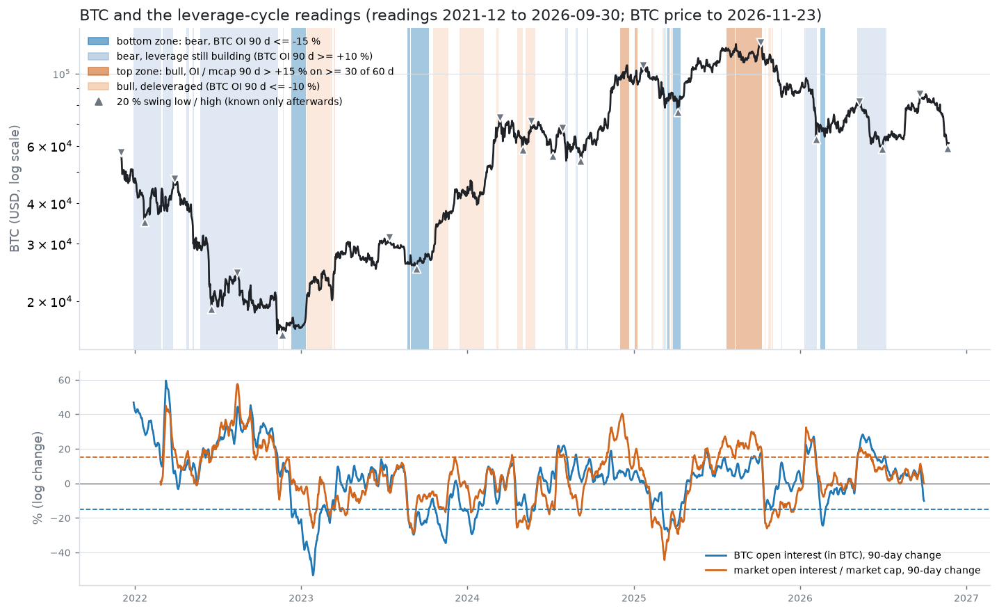

# 01: BTC mid/long-term tops and bottoms

**Question.** Can price action and whole-market perp microstructure tell when BTC is at, or near, the top or bottom
of a mid/long-term cycle (about 6 months), so that one can say "the market is bearish, but the bottom is in or
close: from here it moves sideways or rebounds", and the same for tops?

**Answer.** Yes for **leverage**, which works on both sides, and no for everything else tested:

- **Bottom near:** a bear market in which BTC open interest, counted in BTC, has been flushed: down 15 % or more
  over 90 days.
- **Not a bottom:** a bear market in which open interest is still rising.
- **Top near:** a bull market in which market-wide open interest relative to market cap has kept rising for weeks.

Price-only signals (depth of the drawdown, distance below the moving averages, time since the high), funding,
liquidation spikes, breadth and altcoin froth do not add a usable signal at this horizon. Several of them work the
wrong way round.

The sample is short: 2021-12 → 2026-09, with 4 bottom episodes and 2 top episodes. Treat the rules as a strong
hypothesis, not a proven system.

## Data

All data is Binance.

| Source | Window | Used for |
|---|---|---|
| Binance BTCUSDT daily klines, public API (`cmarketlab.data.btc_daily("spliced")`, cached in `cache/`): USDT-M perpetual from 2019-09-08, spot before it; volume from spot throughout | 2017-08-17 → 2026-11-23 | BTC price, price-action features, targets |
| Binance USDT perps, 897 symbols, daily from hourly (Amberdata; shared-data `binance-perps-1h`) | 2021-09 → 2026-09-30 | market features |

**Cross-checks.**

- The API's BTCUSDT perpetual close matches the Amberdata file's BTC exactly on all 1,835 common days.
- Spot differs from the perpetual by a median of 0.05 %.

**Crypto universe**, each day:

- not one of the 210 TradFi / index perps: stocks, ETFs, metals, FX, BTCDOM, DEFI and similar, detected because
  their weekend volume collapses;
- listed for at least 60 days;
- at least $1M median daily volume over 30 days.

That leaves 140 to 490 symbols a day. Delisted coins stay in while they traded.

## Targets

On day *t*, with horizon *h* = 90, 180 (main) or 365 days:

- **bottom near** (judged on bear days, BTC below its 200-day average): the lowest low in the next *h* days is
  less than 15 % below today's close;
- **top near** (judged on bull days, BTC above its 200-day average): the highest high in the next *h* days is less
  than 15 % above today's close.

Base rates at 180 days, 2018–2026: 31 % of bear days had the bottom near, and 25 % of bull days had the top near.
Price features are tested from 2018-03 (2018-08 for the 365-day ones). Market features are tested from 2021-12.

## Hypotheses and tests

29 features, each with a direction stated before testing. Definitions are in `features.py`; full results are in
`reports/feature_tests.csv`.

**Statistic: AUC, signed by the hypothesis.** The AUC is the probability that the feature ranks a day where the
extreme was near above a day where it was not. Above 0.5 means the data supports the hypothesis.

**Significance: circular-shift test.** The feature is shifted against the target by 180 days or more, 400 times.
Shifting keeps each series' autocorrelation, which is essential with slow cycle data.

AUC at 180 days, with its shift-test p in brackets:

| Hypothesis | Feature | Bottoms | Tops | Verdict |
|---|---|---|---|---|
| H1 a deep drawdown marks the bottom | drawdown from 365-day high | 0.48 (0.73) | | **rejected**: AUC 0.70 to 2022, 0.24 from 2023 (drawdowns of 27–44 % kept falling in 2022 and 2026) |
| H2 far below / above the long averages | close / 200-day and 365-day MA | 0.47 / 0.51 | 0.58 / 0.60 | rejected (bottoms), weak (tops) |
| H3 bear / bull duration | days since 365-day high / low | 0.60 (0.43) | 0.67 (0.21) | not significant |
| H4 no new lows: base building | days since 90-day low | 0.46 | | rejected |
| H5 trend deceleration | 30-day vs 180-day pace | 0.51 | 0.62 (0.14) | weak |
| H6 capitulation volume | 7-day spot volume spike, last 60 days | 0.50 (0.96) | | rejected |
| H7 funding washed out / hot | OI-weighted funding, 30 days | 0.63 (0.88) | 0.58 | not significant |
| H7b funding broadly negative | share of perps with negative funding | **0.31** | 0.52 | **wrong way**: negative funding came before further falls |
| **H8 leverage flushed / built up** | **BTC OI in BTC, 90-day change** | **0.87 (0.01)** | 0.66 (0.26) | **supported for bottoms** at all horizons (0.77 / 0.87 / 0.85, p 0.03 / 0.01 / 0.00) |
| **H8b** | **market OI / market cap, 90-day change** | **0.83 (0.02)** | 0.66 (0.33) | **supported for bottoms**; tops via persistence (below) |
| H9 liquidation capitulation | long liquidations / OI, max 60 days | **0.36** | | wrong way: big flushes in 2022 were followed by more |
| H10 breadth washout / froth | share above 100-day MA; its change | 0.54 / 0.41 | 0.62 / 0.50 | no signal |
| H11 altcoin froth | alts vs BTC 90 days; share up > 100 %; alt volume share; listings | 0.57 / – / 0.46 / 0.41 | 0.63 / 0.72 / 0.53 / 0.70 | tops: some signal, not significant, early |
| H12 volume euphoria / apathy | market volume 30 / 365 days | 0.69 (0.69) | 0.75 (0.13) | tops: some signal, not significant |
| H13 correlation spike at capitulation | median alt–BTC correlation | 0.57 | 0.54 | no signal |

The leverage result is not momentum in disguise:

- **Within momentum terciles:** inside each third of 90-day BTC momentum, the OI change still ranks bottom days
  with AUC 0.79–0.90.
- **Regression:** in a logistic regression with HAC errors, its z-statistic is −6.1, while momentum and the
  200-day MA lose their significance once it is added.

## The rule set: leverage-cycle readings

The rules are implemented as `cmarketlab.indicators.cycle.leverage_cycle`, which is reusable. Each change below is
the 90-day log change of a 7-day mean.

| Reading | Rule | Meaning |
|---|---|---|
| **bottom zone** | BTC < 200-day MA and BTC OI (in BTC) 90-day change ≤ −15 % | bear, leverage flushed: bottom in or close |
| bear, leverage building | BTC < 200-day MA and BTC OI 90-day change ≥ +10 % | bear continues: not a bottom |
| bear | other bear days | no reading |
| **top zone** | BTC > 200-day MA and market OI / market cap 90-day change > +15 % on ≥ 30 of the last 60 days | sustained leverage build-up: top in or close |
| bull, deleveraged | BTC > 200-day MA and BTC OI 90-day change ≤ −10 % | weak: not reliable after 2023 |
| bull | other bull days | no reading |

**What followed each reading**, 2021-12 → 2026-09 (`reports/zones.csv`):

| Reading | Days | No further 15 % fall, 180 d | No further 15 % rise, 180 d | Median return 90 / 180 / 365 d |
|---|---|---|---|---|
| **bottom zone** | 117 | **97 %** | 0 % | **+55 / +80 / +128 %** |
| bear | 303 | 37 % | 48 % | −9 / +8 / +83 % |
| bear, leverage building | 343 | **7 %** | 43 % | −11 / **−15** / +25 % |
| all bear days | 763 | 33 % | 38 % | −3 / +3 / +33 % |
| **top zone** | 106 | 0 % | **84 %** (92 % at 90 d) | **−19 / −37 / −30 %** |
| bull, deleveraged | 226 | 58 % | 13 % | +22 / +33 / +104 % |
| bull | 544 | 36 % | 22 % | +2 / +17 / +56 % |
| all bull days | 876 | 38 % | 27 % | +4 / +18 / +57 % |

**Episodes** (first day of each zone after 60 quiet days; `reports/episodes.csv`):

| Reading | Date | BTC | Nearest extreme (±180 d) | Next 180 d: return / worst / best |
|---|---|---|---|---|
| bottom zone | 2022-12-11 | 17.1k | low 2022-11-21, 20 d earlier, +9 % above it | +55 % / −5 % / +82 % |
| bottom zone | 2023-08-23 | 26.4k | dip inside the bull market | +96 % / −6 % / +100 % |
| bottom zone | 2025-03-09 | 80.7k | dip inside the bull market (the low came 2025-04-08, −8 %) | +37 % / −8 % / +54 % |
| bottom zone | 2026-02-15 | 68.8k | low 2026-06-30 at 58.5k, 135 d later | −8 % / −16 % / +20 % (miss by 1 point: early, then sideways) |
| top zone | 2024-12-01 | 97.3k | top 2025-01 at 106k (+9 %) | +7 % / −24 % / +15 % (borderline) |
| top zone | 2025-07-23 | 118.8k | top 2025-10-06 at 124.7k (+5 %) | −22 % / −32 % / +6 % |
| bear, leverage building | 2021-12-29 | 46.5k | | −55 % / −62 % / +5 % (correct warning) |
| bear, leverage building | 2024-08-03 | 60.7k | | +73 % / −19 % / +81 % (wrong) |
| bear, leverage building | 2025-11-20 | 86.6k | | −11 % / −31 % / +13 % (correct) |
| bear, leverage building | 2026-05-06 | 81.4k | | −6 % / −29 % / +7 % (correct) |

**Robustness.**

- **Target threshold:** for further-move thresholds of 10–25 % and horizons of 90–365 days, the bottom zone hits
  75–100 % (base 25–66 %) and the top zone 42–100 % (base 11–69 %).
- **By half:** the bottom zone hit 100 % of days to 2023 and 89 % from 2024. Bear-with-building-leverage was
  2 % and 23 %.
- **Top zone:** it only exists from 2024. The window starts after the 2021 top, so there was no earlier bull-market
  top to test it on.



## Interpretation

- **Bottoms.** A falling market in which traders keep adding open interest is still being fought: new shorts
  pile in, and longs keep buying the dips with leverage. That fuel has to burn off before a durable low.
  - Once open interest in coin terms has dropped 15 % or more over three months, forced and voluntary sellers are
    largely out. From there the market has rebounded or gone sideways.
  - Price depth alone does not show this: 2022 had −60 % drawdowns with open interest still rising. Depth worked
    in 2018–2022 (AUC 0.70) and failed from 2023 (0.24), so it is not a stable signal.
- **Tops.** Mid-cycle tops in 2024–25 came after leverage had grown faster than market cap for one to two months
  straight. A single burst of froth (volume, alt gainers, leverage) fires too early. The persistence condition is
  what makes it a late-cycle signal.
- **What does not work.**
  - Negative funding and liquidation spikes marked capitulation *events*, not the end of the bear: in 2022 both
    came before the next leg down.
  - Drawdown and moving-average discounts mix shallow bull-market dips (which recover) with real bear markets
    (which keep falling).

## Limits

- **Short history.** About 5 years of market data, 4 bottom-zone and 2 top-zone episodes. The thresholds (−15 %,
  +15 %, 30 of 60 days) were chosen on this same sample, so expect worse live hit rates. The 2026-02 episode
  already shows the rule can be months early.
- **One venue.** OI is Binance USDT-margined only. Shifts of open interest between venues or to coin-margined
  contracts would distort the signal. Normalising by market cap (H8b) helps for the market measure.
- **Labels are about magnitude, not timing.** "Bottom near" allows the low to come later, as long as it is less
  than 15 % below.
- **No pre-2021 test of the leverage rules.** The leverage features start in 2021-12. The 2017–2021 Binance price
  history can test only the price features, which failed (2018 bear, 2019 top, 2020 crash, 2021 tops included).
  Binance's open-interest history API covers only the last 30 days, so the leverage series cannot be extended
  back from the API.

## Latest reading

As of 2026-09-30, the last day of market data, the reading is "bull, deleveraged": BTC 83.6k, 16 % above its
200-day MA, BTC OI −10 % over 90 days.

BTC has since fallen to 61.2k (2026-11-23 close, Binance API), 15 % below its 200-day MA, so the state is now
bear. Whether that is a bottom zone or "leverage building" depends on the open-interest change since September,
which the perps file does not cover yet. The Binance API serves only the last 30 days of open interest, so a
current reading needs the file refreshed.

## Reproduce

```
.venv\Scripts\python.exe research\01_btc_cycle\01_cycle_extremes\features.py      # feature table -> cache/ (about 20 s)
.venv\Scripts\python.exe research\01_btc_cycle\01_cycle_extremes\run.py tests     # hypothesis tests (about 3 min)
.venv\Scripts\python.exe research\01_btc_cycle\01_cycle_extremes\run.py zones     # rule readings, episodes
.venv\Scripts\python.exe research\01_btc_cycle\01_cycle_extremes\run.py chart     # reports/leverage_cycle.png
.venv\Scripts\python.exe research\01_btc_cycle\01_cycle_extremes\run.py current   # latest reading
```

## TradingView

`tradingview/leverage_cycle.pine` (overlay: background by reading, episode labels, current-value table, alerts)
and `tradingview/leverage_cycle_pane.pine` (the two leverage lines with thresholds). Use both on a 1D BTC chart.

- **Bottom rules:** same as here, using `BINANCE:BTCUSDT.P_OI` and `BINANCE:BTCUSDT.P`.
- **Top rule (approximation):** Pine allows only 40 data requests, so market leverage uses 9 majors (BTC, ETH,
  SOL, XRP, BNB, DOGE, ADA, LINK, AVAX) divided by `CRYPTOCAP:TOTAL` minus USDT and USDC.
  - Checked on the study data (with the universe's summed market cap standing in for TOTAL): 0.97 correlation
    of the 90-day change with the full measure.
  - The same two top-zone episodes (starting 2024-12-03 and 2025-07-19).
  - 128 top-zone days instead of 106, with a 180-day hit rate of 75 % instead of 84 %.
- **Data source:** TradingView's open-interest history comes from its own feed, not Amberdata, so readings near a
  threshold can differ by a day or two.

## Code added to the package

- `cmarketlab/data/binance.py`: Binance public-API klines (spot / USD-M), cached and extended incrementally;
  `btc_daily`.
- `cmarketlab/data/daily.py`: daily bars from the perps file, cached.
- `cmarketlab/data/universe.py`: crypto universe, TradFi filter.
- `cmarketlab/indicators/trend.py`: price-action features.
- `cmarketlab/indicators/market.py`: market-wide breadth, funding, leverage, liquidations, alt strength,
  correlation, volume.
- `cmarketlab/indicators/cycle.py`: the leverage-cycle readings.
- `cmarketlab/labels/cycles.py`: zigzag pivots, forward outcomes.
- `cmarketlab/evaluation/signals.py`: AUC, circular-shift test, quantile tables, episodes.
